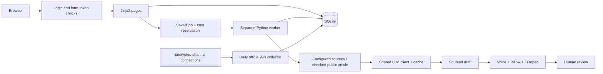

# Private control center

The browser now covers the local C.1–C.5 workflow. It uses FastAPI, Jinja2,
SQLite and ordinary Python processes. The theme uses warm neutral surfaces,
charcoal text and a muted olive accent. No fonts, charts or scripts load from
third-party CDNs.

## Run it

```bash
source .venv/bin/activate
pip install -r requirements.txt
python -m src.dashboard.app
```

Open http://localhost:8000 and use your existing login. Restart a dashboard
process that was running before the upgrade. Database changes are additive and
run on startup; no existing videos, passwords or review notes are removed.

Back up the database, output directory and encryption secret before moving to
another machine. `DATABASE_PATH` selects the database; Docker uses `/app/data/`.

## Pages

| Page | What it does |
| --- | --- |
| Overview | Totals across channels, channel cards, cumulative follower/view charts and recent activity |
| Channels | Each channel's connected accounts, daily followers, recent videos and best performers |
| Video library | Search titles, filter channels/status, play private MP4s, see cached thumbnails and durations |
| Review queue | Read sources and scripts, watch renders, approve or reject content |
| Money | Record USD payouts and expenses; see monthly totals, profit and the cost ledger |
| New video | Find recent sources, optionally rank them, use an article URL, create a script or animated video |
| Activity | Persistent progress, outcomes, saved drafts and errors for background jobs |

A dash means no statistics have been collected. A numeric zero means a real
observation reported zero. Overview publication counts use **confirmed public
post IDs**. Legacy `posted` statuses can include TikTok inbox deliveries; those
are not automatically counted as public posts.

Files under `output/videos/` that are missing from the database appear as **Not
in database**. Their source, cost and review status remain unknown. The library
does not automatically approve or publish them. Video and thumbnail URLs require
login, including requests for part of a video while seeking. Files and symlinks
outside `output/` cannot be served through these routes.

## Create a video

1. Open **New video**, choose a channel, and find recent stories. A topic filters
   the channel's current feed results and, if the channel has a `search:` section,
   also searches recent news across the web (GDELT, plus NewsAPI when
   `NEWS_API_KEY` is set). Both are free; results are saved for 15 minutes.
   Every result links to a real article; nothing creates a source-free script.
   Google News was tested and left out: its links don't lead to the article text.
   Optional AI ranking shows its spending allowance before submission.
2. Choose a story or paste a public article URL. The worker checks that meaningful
   source text is available before asking the writing model for a script.
3. Choose **Script for review** or **Script + animated video**. Free Edge speech
   is the default for browser jobs. The channel's configured voice is also an
   option; the news channel currently uses ElevenLabs.
4. A **dry run** checks the source but skips paid writing, voice generation and
   rendering. It does not create a pretend video in the review queue.
5. Watch Activity for progress. A successful script or video stays **drafted**.
   If rendering fails after writing, the saved draft remains available.
6. Review the script, source and on-screen claims. A script can also be rendered
   later from its detail page. Rendering returns the result to the review queue.

The example Twitch channel is disabled until its sources and permissions are
configured. Browser source generation currently supports article-based channels;
it does not implement a Twitch clip editor.

The only browser job that posts is **Post now** on an approved, rendered video
(tick "I understand this video will be posted publicly"). It posts to every platform
in the channel's `platforms:` list: Instagram and Facebook Page Reels go public at
once; TikTok lands in the inbox; YouTube uses the channel's requested privacy, checked against the upload response. Already-successful platforms are skipped, so
clicking again after fixing a problem only retries the rest. A channel `schedule:`
block posts the newest approved video automatically at set times.

You can still post by hand in the platform apps. On a video's detail page, record
its actual numeric public post ID after posting; the account collector can then
query that video's statistics.
A TikTok `publish_id` from inbox upload is a different identifier. Only an
approved video can be recorded as posted, and a rejected draft can be approved
again from its detail page if you change your mind.

## Spending and worker behavior

`config/dashboard.yaml` contains the daily dollar limit, number of heavy jobs
allowed in progress, job timeout and heartbeat timeout. Defaults are **$2 per UTC
day**, **one heavy job (writing or rendering) in progress**, and **60 minutes per
job**. Finding stories and collecting statistics are light jobs: they can run
while a video renders, one of each per channel at a time.

Each paid job reserves a conservative allowance calculated from the configured
models, token ceilings and optional voice characters. The actual amount is often
lower; unused allowance is released when the job finishes. Every paid call is
checked before sending. A script longer than the voice allowance stops before
voice generation. Dry runs and free source discovery remain available even if
the spending limit has been reached.

New AI calls are recorded in `cost_events`, including failed runs. Voice calls
use `video.elevenlabs_usd_per_1000_chars` and the selected model in the channel
YAML. This is an estimate, not an invoice: subscriptions and included credits
change the billed amount. Cached results add no new charge. Requests without a
known response retain a conservative **uncertain** estimate. API requests do not
silently retry a possibly charged request.

The ledger combines new cost events, manual entries and earlier saved video
costs, subtracting linked cost events from legacy totals to avoid double-counting.
Older failed runs and voice charges were not reliably recorded; reconcile those
with manual expenses. The old CSV is retained as a run log, not imported as a
second copy of database spending. CLI runs record costs too; the **daily cap is
for browser jobs**, not a global billing lock on independently started CLI runs.

New timestamps use UTC. Historical local timestamps are interpreted using the
server's local time zone for daily spending checks. Manual money entries use the
date you enter.

Jobs are saved in SQLite before a separate Python process starts. Reloading or
double-clicking a submitted form does not start it twice. Capacity and spending
reservations happen inside one database transaction. Workers record a heartbeat;
a stopped worker becomes **interrupted**, with no automatic paid retry. Review
its draft and uncertain charges before starting again. Active renders cannot be
approved or picked up by the scheduler. Videos with publishing history cannot be
re-rendered over their existing output.

## Connect accounts

Connections can be added on each channel page using official OAuth or an existing
access token. Tokens are verified before saving, encrypted with PyCA Fernet, and
never shown in HTML or stored in browser cookies. An account can belong to only
one channel. Importing the old `.env` token is an explicit action for a selected
channel; its mere presence does not mean that channel is connected.

### TikTok

Set these in `.env` and restart the dashboard:

```dotenv
# App credentials from the TikTok developer portal.
TIKTOK_CLIENT_KEY=your-client-key
TIKTOK_CLIENT_SECRET=your-client-secret
# Must exactly match the callback registered with the developer app.
TIKTOK_REDIRECT_URI=https://your-approved-dashboard-domain/oauth/tiktok/callback
```

The login flow requests `user.info.basic`, `user.info.stats`, `video.list` and
`video.upload`. The app needs permission to use those scopes. Token expiry is
read from the returned `expires_in`; refresh tokens are replaced when rotated.
Pasted tokens have no known refresh credentials and may need manual renewal.

### Instagram

This implementation uses **Instagram API with Facebook Login**, for a professional
Instagram account linked to a Facebook Page. It does not interchange tokens from
Meta's separate Instagram Login product.

```dotenv
# Credentials of your Meta developer app.
META_APP_ID=your-app-id
META_APP_SECRET=your-app-secret
# Must exactly match the registered callback.
INSTAGRAM_REDIRECT_URI=https://your-approved-dashboard-domain/oauth/instagram/callback
# Change deliberately when migrating to another supported Graph version.
META_GRAPH_VERSION=v24.0
```

Enter the numeric Instagram professional account ID on the connection form. The
flow requests `instagram_basic`, `instagram_manage_insights`,
`instagram_content_publish`, `pages_show_list`, `pages_read_engagement` and
`pages_manage_posts`, exchanges the token for a long-lived user token, and
verifies access to that account. Accounts connected before publishing was added
must be **reconnected once** to grant the two posting permissions.

**Facebook Page posting** uses this same connection. The Instagram account must be
linked to a Facebook Page you manage; each post looks up that Page and its own
token (never stored). While the Meta app is in Development mode, posting works for
accounts that have a role on the app (add yourself under App roles), without App
Review. Making the app public to other people's accounts needs App Review. Reconnect expired Meta tokens. App approval and
account-role requirements still apply; they cannot be validated without your
real developer app and account.

### YouTube

YouTube Shorts use the official **YouTube Data API v3** with Google's OAuth login.
Check your Google Cloud project quotas. Current documentation lists 100 uploads/day
in a separate video-upload quota bucket; see [the current quota guide](https://developers.google.com/youtube/data/guides/quota_and_compliance_audits).

1. In Google Cloud Console create a project and enable **YouTube Data API v3**.
2. **OAuth consent screen**: choose External, add your Google account as a test
   user, then set the publishing status to **In production**. In "Testing", Google
   refresh tokens expire after 7 days and you would have to reconnect weekly. An
   unverified production app only shows *you* an "unverified app" warning.
3. **Credentials → Create OAuth client ID → Web application**, with the redirect
   URI `http://localhost:8000/oauth/youtube/callback` (or your hosted address).
4. Put `GOOGLE_CLIENT_ID`, `GOOGLE_CLIENT_SECRET` and `YOUTUBE_REDIRECT_URI` in
   `.env`, restart the dashboard and press **Connect with Google** on the channel page.

The login asks for `youtube.upload` and `youtube.readonly` with offline access, so
the one-hour access token renews automatically. Pasting a token is disabled for
YouTube because it could not be renewed.

**Privacy:** the channel's `youtube.privacy` setting requests private, unlisted or
public uploads. The app counts a public post only when YouTube's response says
public. A private/unlisted upload still succeeds as a delivery. After changing it
to public in Studio, record its video ID on the video page to collect statistics.
Current upload documentation no longer says unverified projects are categorically
restricted to private uploads. YouTube reports views, likes and comments but not
shares, so shares stay empty.

### Encryption and daily collection

By default the account encryption key is derived from `SESSION_SECRET` with a
separate purpose label. Changing that secret logs browsers out **and requires
reconnecting accounts**. To keep account encryption independent, set a dedicated
`ACCOUNT_TOKEN_KEY` **before** adding connections:

```bash
python -c "from cryptography.fernet import Fernet; print(Fernet.generate_key().decode())"
```

Keep the generated value only in `.env` and back it up privately with the database.
Do not change this key without reconnecting accounts. Disconnecting removes the
local credentials and follower history; revoke app permissions in platform
settings if desired.

While the dashboard runs, a background collector checks for missing daily account
and public-post snapshots every fifteen minutes. Repeated collections skip
successful snapshots from the same UTC day. Separate collection locks prevent
simultaneous manual and automatic requests from duplicating records. Errors appear
on channel pages; missing API results are not saved as zero counts.

Set `DASHBOARD_AUTO_COLLECT=false` to turn off that loop. A server scheduler can
instead invoke the same collector once daily:

```bash
python -m src.analytics.accounts --dry-run
python -m src.analytics.accounts --channel news
```

The TikTok scheduler now uses the channel's encrypted connection. Legacy global
tokens require the explicit channel option `publishing.use_legacy_env_tokens`;
leave it false for multiple channels. Instagram and Facebook posting send the MP4
directly to Meta (resumable upload), so no public hosting is required. No hosting
or public access was enabled by this update.

## Architecture and verification



```bash
pytest -q
pytest -q tests/test_control_center.py
```

Tests use temporary databases and mocked platform/AI requests. They cover login
and form protection, encrypted tokens, one-use OAuth state, refresh rotation,
latest-snapshot totals, duplicate submissions, concurrent job admission, spending
limits, source failures, SSRF/redirect defenses, successful/failed renders, real
subprocess startup, private range requests, and local FFmpeg media previews when
FFmpeg is installed. No paid API requests are needed.

Developer references:

- [TikTok user information](https://developers.tiktok.com/docs/en/tiktok-api-v2-get-user-info)
- [TikTok video queries](https://developers.tiktok.com/docs/en/tiktok-api-v2-video-query)
- [TikTok OAuth token lifecycle](https://developers.tiktok.com/docs/en/oauth-user-access-token-management)
- [Meta's official Instagram API collection](https://www.postman.com/meta/instagram/collection/6yqw8pt/instagram-api)
- [PyCA cryptography](https://github.com/pyca/cryptography) — selected over lower-level alternatives for its adoption and authenticated-encryption recipe.


### Stream clips automation

Open **Stream clips** for streamer permissions, live status, recording ingestion,
scored candidates and Start/Stop controls. Review and scheduled-publishing dry runs
are enabled by default. [Operating guide](stream-clips.md).
